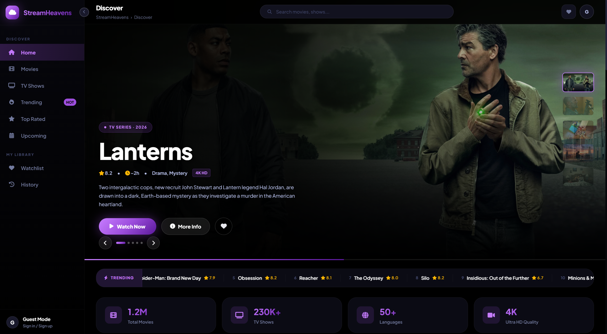
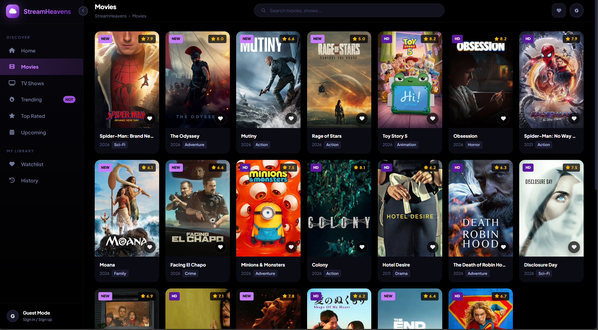
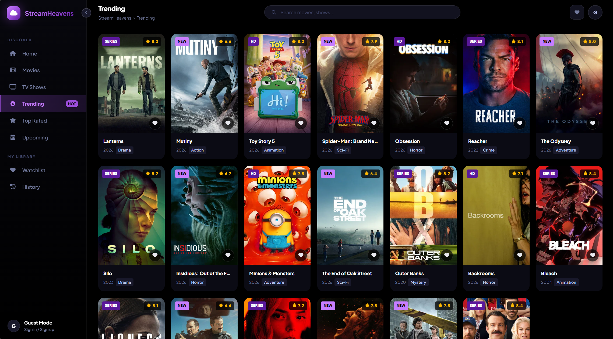
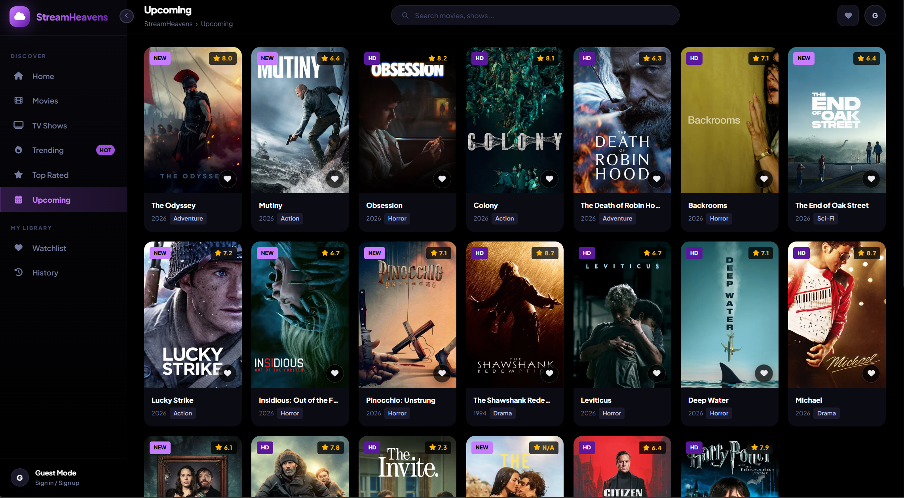
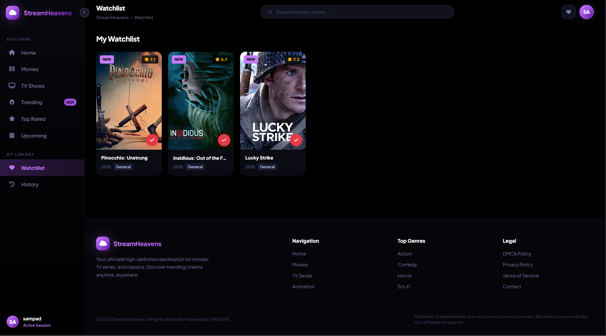

# 🌌 StreamHeavens — Development Repository

> **⚠️ CONFIDENTIAL — DO NOT MAKE THIS REPOSITORY PUBLIC.**



This is the private development codebase for **StreamHeavens**, a premium movie and TV series discovery and streaming web application. This repository contains the full frontend source code and the Cloudflare Pages serverless proxy function.

---

## 📖 Table of Contents

- [Architecture Overview](#-architecture-overview)
- [Project Structure](#-project-structure)
- [Tech Stack](#-tech-stack)
- [Core Modules](#-core-modules)
- [Setup & Local Development](#-setup--local-development)
- [Cloudflare Deployment](#-cloudflare-deployment)
- [Environment Variables](#-environment-variables)
- [Screenshots](#-screenshots)
- [Roadmap](#-roadmap)

---

## 🏗️ Architecture Overview

StreamHeavens follows a **JAMstack-inspired architecture** optimized for edge deployment:

```
┌─────────────────────────────────────────────────────┐
│                   USER'S BROWSER                    │
│         (HTML + CSS + Vanilla JavaScript)            │
│                                                     │
│  index.html ─── style.css ─── script.js             │
│       │                                             │
│       ▼                                             │
│  Fetch requests to /api/tmdb/*                      │
└────────────────────┬────────────────────────────────┘
                     │ HTTPS
                     ▼
┌─────────────────────────────────────────────────────┐
│           CLOUDFLARE PAGES FUNCTION                 │
│      functions/api/tmdb/[[path]].js                 │
│                                                     │
│  1. Intercepts /api/tmdb/* requests                 │
│  2. Injects TMDB_API_KEY from env variables         │
│  3. Forwards request to TMDB API                    │
│  4. Returns JSON response with CORS headers         │
│  5. Caches responses for 5 minutes                  │
└────────────────────┬────────────────────────────────┘
                     │ HTTPS
                     ▼
┌─────────────────────────────────────────────────────┐
│          TMDB API (api.themoviedb.org/3)             │
│                                                     │
│  Provides: Movie/TV metadata, posters, backdrops,   │
│  cast info, genres, ratings, release dates           │
└─────────────────────────────────────────────────────┘
```

**Key Design Decisions:**
- **Zero frameworks** — Pure HTML/CSS/JS for maximum performance and zero build step.
- **Server-side API key injection** — The `TMDB_API_KEY` is never exposed to the browser. The Cloudflare function acts as a secure proxy.
- **Edge caching** — API responses are cached for 5 minutes at the edge (`Cache-Control: public, max-age=300`).
- **Content Security Policy (CSP)** — Strict CSP headers in `index.html` whitelist only trusted domains.

---

## 📁 Project Structure

```
streamheavens/
├── assets/                        # Screenshots for README documentation
│   ├── Home.png
│   ├── Movies.png
│   ├── TV Shows.png
│   ├── Trending.png
│   ├── Top Rated.png
│   ├── Upcoming.png
│   ├── Watchlist.png
│   ├── Sign In.png
│   └── Sign Up.png
├── functions/                     # Cloudflare Pages serverless functions
│   └── api/
│       └── tmdb/
│           └── [[path]].js        # Catch-all TMDB API proxy
├── index.html                     # Single-page application (544 lines)
├── style.css                      # Complete stylesheet (46KB)
├── script.js                      # Application logic (1089 lines, 57KB)
├── README.md                      # This file (Development docs)
└── SHOWCASE_README.md             # Public-facing README for showcase repo
```

---

## 🛠️ Tech Stack

| Layer | Technology | Purpose |
|-------|-----------|---------|
| **Markup** | HTML5 | Semantic structure, SEO meta tags, PWA manifests |
| **Styling** | CSS3 | Custom properties, Flexbox/Grid, animations, glassmorphism |
| **Logic** | Vanilla JavaScript (ES6+) | SPA routing, API calls, state management, DOM rendering |
| **Icons** | FontAwesome 6.4.0 | 40+ UI icons across the interface |
| **Typography** | Google Fonts (Plus Jakarta Sans) | 6 weights: 400–900 |
| **Data API** | TMDB API v3 | Movie/TV metadata, images, cast, ratings |
| **Streaming** | VidLink, VidSrc, AutoEmbed | 3 third-party embed providers |
| **Serverless** | Cloudflare Pages Functions | API proxy with secret injection |
| **Hosting** | Cloudflare Pages | Edge deployment with global CDN |

---

## 🧩 Core Modules

The `script.js` is organized into **11 self-contained modules**:

| # | Module | Description |
|---|--------|-------------|
| 00 | `UIHelper` | Scroll lock/unlock utility to prevent background scroll when modals are open |
| 01 | `CFG` | Global configuration — API base URL, image CDN paths, streaming server definitions, genre mappings |
| 02 | `State`, `Utils`, `API`, `Prog`, `Toast` | Application state, string utilities, TMDB API wrapper, progress bar, toast notifications |
| 03 | `Sidebar`, `MobNav`, `App`, `Search` | UI navigation, mobile hamburger menu, SPA page routing, real-time TMDB search with debounce |
| 04 | `Spotlight` | Auto-rotating hero slider with progress bar, thumbnail strip, dot navigation, and 6-second intervals |
| 05 | `initDragScroll()` | Mouse drag-to-scroll for horizontal carousels (desktop) |
| 06 | `Render`, `Browse` | Card rendering engine (poster, landscape, compact layouts), grid/browse page data loading with skeleton placeholders |
| 07 | `Modal`, `Player`, `FVTabs` | Full-screen detail modal, multi-server iframe player, tabbed content (Overview/Watch/Cast) |
| 08 | `Watchlist`, `History` | Add/remove favorites, watch history tracking (max 50 entries), localStorage persistence |
| 09 | `Legal` | DMCA, Privacy Policy, Terms of Service, Contact — rendered in a dedicated legal modal |
| 10 | `Auth` | Local authentication system with signup/login/logout, per-user watchlist and history sync via localStorage |

---

## 🚀 Setup & Local Development

### Prerequisites
- [Node.js](https://nodejs.org/) v16+ & npm
- [Wrangler CLI](https://developers.cloudflare.com/workers/wrangler/) (Cloudflare's local dev tool)

### Step-by-Step

1. **Clone the repository**
   ```bash
   git clone https://github.com/SamJU25/steamheavens.development.git
   cd steamheavens.development
   ```

2. **Create a `.dev.vars` file** in the project root to store your API key locally:
   ```env
   TMDB_API_KEY=your_actual_tmdb_api_key_here
   ```
   > ⚠️ This file is for local development only. Never commit it to Git. Add `.dev.vars` to your `.gitignore`.

3. **Start the local Cloudflare dev server**
   ```bash
   npx wrangler pages dev .
   ```
   This will:
   - Serve the static files (`index.html`, `style.css`, `script.js`)
   - Boot the serverless function at `/api/tmdb/*`
   - Open a local server (usually `http://localhost:8788`)

4. **Open in browser** — Press `b` in the terminal or navigate to the URL manually.

### Alternative (Frontend-Only, No API Proxy)
If you just want to preview the UI without the API:
```bash
npx serve .
```
> Note: API calls will fail without the proxy, but you can inspect the layout and animations.

---

## ☁️ Cloudflare Deployment

### Initial Setup
1. Go to [Cloudflare Pages Dashboard](https://dash.cloudflare.com/).
2. Create a new project → Connect to your **Private GitHub Repository**.
3. Set Build settings:
   - **Build command:** *(leave empty — no build step needed)*
   - **Build output directory:** `/` *(root, since there's no build)*
4. Add the environment variable:
   - **Variable name:** `TMDB_API_KEY`
   - **Value:** Your actual TMDB API key

### Updating the Live Site
Simply push to the `main` branch:
```bash
git add .
git commit -m "Your update message"
git push
```
Cloudflare will automatically detect the push and redeploy within ~60 seconds.

### Custom Domain
1. In Cloudflare Pages → Your project → Custom domains
2. Add your purchased domain
3. Cloudflare will automatically provision an SSL certificate

---

## 🔐 Environment Variables

| Variable | Required | Description |
|----------|----------|-------------|
| `TMDB_API_KEY` | ✅ Yes | Your TMDB v3 API key. Obtain from [TMDB Developer Portal](https://developer.themoviedb.org/docs/getting-started). |

**Local development:** Store in `.dev.vars` (never commit this file).  
**Production:** Set in Cloudflare Pages → Settings → Environment Variables.

---

## 📸 Screenshots

### 🏠 Home — Hero Spotlight with Auto-Rotating Slider


---

### 🎬 Movies — Poster Grid with Ratings & Badges


---

### 📺 TV Shows — Full Catalog Browse


---

### 🔥 Trending — What Everyone is Watching


---

### ⭐ Top Rated — Critically Acclaimed Titles


---

### 📅 Upcoming — Coming Soon Releases


---

### ❤️ Watchlist — Personal Favorites Collection


---

### 🔑 Authentication — Sign In & Sign Up

<p align="center">
  
  
</p>

---

## 🗺️ Roadmap

- [ ] Backend database (Supabase/Planetscale) for persistent user accounts
- [ ] Server-side session management with JWT
- [ ] Ad integration for monetization
- [ ] Progressive Web App (PWA) with offline support
- [ ] Continue watching feature with progress tracking
- [ ] User reviews and ratings
- [ ] Multi-language support (i18n)
- [ ] Admin dashboard for analytics

---

<p align="center">
  <sub>Built with ❤️ by SamJU25 — © 2026 StreamHeavens. All rights reserved.</sub>
</p>
