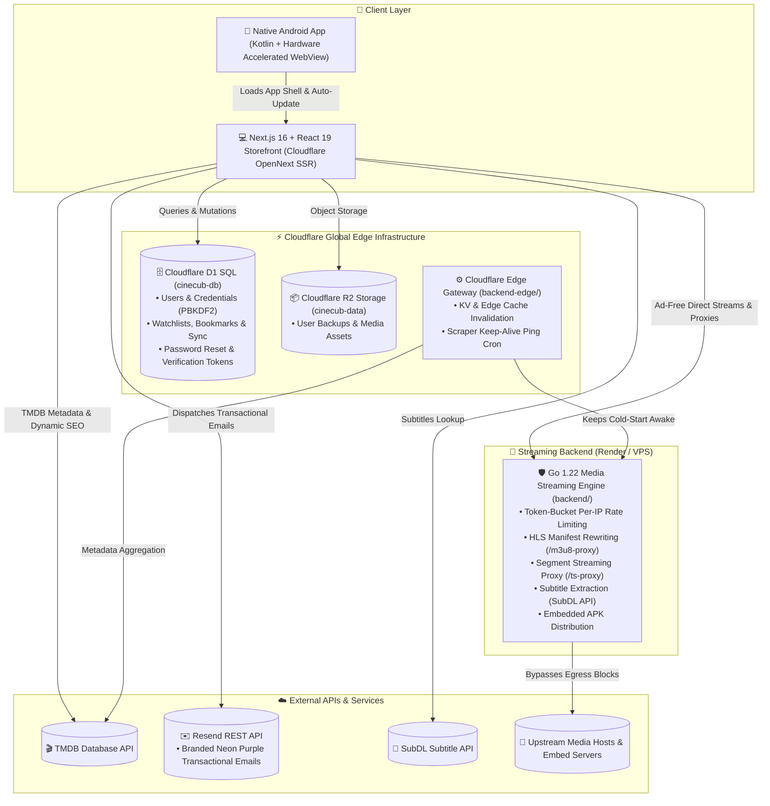

# 🎬 CineCub

## *High-Performance Cinematic Streaming Monorepo & Native Android Ecosystem*

[](https://cinecub.stream)
[](https://cinecub.stream/CineCub.apk)
[](https://workers.cloudflare.com)
[](https://nextjs.org)
[](https://developers.cloudflare.com/d1/)
[](https://developers.cloudflare.com/r2/)
[](https://resend.com)
[](https://go.dev)
[](LICENSE)

**CineCub** is a modern, high-performance cinema and television streaming ecosystem engineered across a distributed serverless and native monorepo:
- **Serverless SSR Storefront**: Built on Next.js 16 (React 19) and deployed globally via Cloudflare Workers and OpenNext.
- **Full Technical SEO Engine**: Server-rendered dynamic metadata (`generateMetadata`), 1280x720 OpenGraph/Twitter social cards, Schema.org JSON-LD (`Movie`, `TVSeries`, `WebSite`), crawlable link architecture, and automated TMDB-backed sitemaps.
- **Serverless Edge Database**: Cloudflare D1 SQL (`cinecub-db`) with edge PBKDF2 cryptography and stateless JWT authentication.
- **Direct & Embed Streaming Pipeline**: Dual-engine playback prioritizing ad-free native MP4/MKV video streams with multi-server embed fallbacks, sub-second latency probing, and SubDL subtitle retrieval.
- **Native Android Application**: Android Kotlin client with hardware-accelerated WebView playback, immersive UI, and background Over-The-Air (OTA) updates.

---

## 📑 Table of Contents

- [Architectural Overview](#architectural-overview)
- [Monorepo Package Layout](#monorepo-package-layout)
- [Key Features & Innovations](#key-features--innovations)
- [SEO & Discoverability Architecture](#seo--discoverability-architecture)
- [Tech Stack at a Glance](#tech-stack-at-a-glance)
- [Local Development Quickstart](#local-development-quickstart)
- [Deployment Pipeline](#deployment-pipeline)
- [Environment Configuration](#environment-configuration)
- [Database Schema (Cloudflare D1)](#database-schema-cloudflare-d1)
- [Performance, Security & Auditing](#performance-security--auditing)
- [License](#license)

---

## Architectural Overview

CineCub separates edge presentation, serverless transactional state, and media streaming proxies across three high-availability layers:



---

## Monorepo Package Layout

```text
CineCub/
├── frontend/
│   ├── next-storefront/         # Next.js 16 + React 19 Storefront deployed on Cloudflare Workers
│   │   ├── src/app/
│   │   │   ├── api/auth/        # Edge Auth routes (signup, login, me, forgot/reset password, email verification)
│   │   │   ├── api/user/sync/   # Cloudflare D1 real-time sync for watchlists & playback history
│   │   │   ├── api/subtitles/   # SubDL subtitles integration and SRT-to-VTT conversion
│   │   │   ├── reset-password/  # Dedicated password reset portal with real-time strength meter
│   │   │   ├── verify-email/    # Instant email verification route and feedback UI
│   │   │   ├── layout.tsx       # Root SSR layout, global robots, OpenGraph fallback & Schema.org WebSite
│   │   │   ├── page.tsx         # Dynamic generateMetadata SSR engine, Movie/TVSeries JSON-LD, cinema feed
│   │   │   ├── sitemap.ts       # Dynamic sitemap pulling trending, popular & anime titles from TMDB
│   │   │   ├── robots.ts        # Next.js native robots directives disallowing internal proxies
│   │   │   └── style.css        # Core design tokens, obsidian dark theme & glassmorphic utilities
│   │   ├── src/components/      # UI components (PlayerModal, DetailModal, Cards, Header, Sidebar, Footer)
│   │   ├── src/lib/
│   │   │   ├── cloudflare.ts    # Cloudflare Workers environment binding loader (D1, R2, env vars)
│   │   │   ├── email.ts         # Zero-dependency Resend email service with CineCub-themed HTML templates
│   │   │   ├── db.ts            # Edge SQL query abstractions and migration helpers
│   │   │   └── auth.ts          # Edge-native PBKDF2 (100k rounds) hashing & JWT validation
│   │   ├── public/              # Static assets, web logo, APK binary, icons, and manifest
│   │   ├── schema.sql           # Cloudflare D1 SQL schema definition
│   │   └── wrangler.jsonc       # Cloudflare Workers config, D1/R2 bindings, custom domain routes
│   └── android-app/             # Native Android Kotlin application
│       ├── app/src/main/        # Kotlin sources (MainActivity, AppUpdater, VideoChromeClient)
│       └── scripts/release.ps1  # Automated release sync script (APK compilation & version.json bump)
├── backend-edge/                # Cloudflare Worker (TypeScript API gateway & scraper keeper)
│   ├── src/index.ts             # Edge router, CORS proxy, and keep-alive crons
│   └── wrangler.toml            # Cloudflare Workers configuration
├── backend/                     # High-performance Go media streaming proxy (Render / VPS)
│   ├── cmd/server/main.go       # Server entrypoint with embedded CineCub.apk distribution
│   ├── internal/providers/      # Stream scrapers (VidLink, FebBox, 4KHDHub, VaPlayer)
│   ├── internal/proxy/          # HLS manifest rewriter & TS chunk stream proxy handlers
│   └── internal/ratelimit/      # Per-IP token-bucket rate limiters
├── directives/                  # Layer 1: Standard Operating Procedures & runbooks
├── execution/                   # Layer 3: Deterministic automation scripts
├── .agents/                     # AI development skills, workflows, and rules
└── .github/workflows/           # CI/CD workflows for automated builds and releases
```

---

## Key Features & Innovations

### 🎨 Signature Neon-Purple Glassmorphic Interface

- **Obsidian Dark Palette**: Curated dark obsidian base (`#08070e`) with electric violet and lavender accents (`#9d4edd`, `#c77dff`, `#7b2cbf`).
- **Hardware-Accelerated Glassmorphism**: Cards and modals utilize GPU-rendered `backdrop-filter: blur(24px)` with subtle gradient borders (`rgba(157, 78, 221, 0.28)`).
- **GPU-Smooth Touch Carousels**: Decoupled swipe gesture arbitration for jitter-free 120fps mobile navigation.

### ⚡ Direct & Ad-Free Streaming Engine

- **Dual Playback Pipeline**:
  1. **Direct Stream**: High-speed native `<video>` MP4/MKV and HLS playback with automated upstream host verification (PixelDrain, Google UserContent, etc.).
  2. **Multi-Server Embed Fallback**: 6 global embed fallback servers (`VidLink`, `VidSrc`, `AutoEmbed`, `SuperEmbed`, etc.) with instant source switching.
- **Smart Latency Probing**: Probes latency headers (`bytes=0-0`) across available streams to auto-select the fastest connection.
- **Full Playback Controls**: Quality selector (4K down to 240p), custom playback speeds (0.5x to 2x), Picture-in-Picture (PiP), and multi-language subtitle download.
- **SubDL Integration**: High-accuracy multi-lingual subtitle lookup using the official SubDL API with automatic language mapping.

### 🛡️ Cloudflare Edge Database & Serverless Auth (Zero Firebase)

- **100% Serverless Edge Stack**: Completely decoupled from Firebase. All user profiles, watchlists, history, and tokens are stored in **Cloudflare D1 SQL** (`cinecub-db`).
- **Edge-Native PBKDF2 Password Security**: Cryptographically secure client password hashing using PBKDF2 (100,000 rounds of HMAC-SHA256).
- **Stateless JWT Sessions**: Fast edge-level session validation without database latency.
- **Cloudflare R2 Object Storage**: S3-compatible cloud storage (`cinecub-data`) for user data exports and backups.

### ✉️ Resend Transactional Email Engine

- **Zero-Dependency Resend REST Integration**: Edge-compatible HTTP client communicates directly with Resend without bloated Node SDK dependencies.
- **Branded Neon Purple Email Templates**:
  - **Password Reset**: Secure 1-hour expiration single-use token links to `/reset-password`.
  - **Email Verification**: One-click verification link to `/verify-email`.
  - **Official Branding**: Includes CineCub's official web logo with purple glow drop-shadow and modern security notice cards.
- **Intelligent Fallback Routing**: Automatically falls back to `onboarding@resend.dev` if custom domain DNS records are pending verification.

### 📱 Integrated Android Native App

- **Hardware-Accelerated WebView**: Full-screen video mode, immersive status bar handling, and gesture controls.
- **Over-The-Air (OTA) Updates**: Background version polling against `version.json` with branded in-app APK download dialogs.
- **Environment-Aware Rendering**: Automatically detects mobile app mode (`CineCubApp`) to hide desktop articles and multi-column footers.

---

## SEO & Discoverability Architecture

CineCub features an enterprise-grade SEO and social sharing engine implemented in accordance with Google Search Central guidelines:

### Dynamic Metadata Generation (`generateMetadata`)

- Individual media URLs (`/?id=157336&type=movie` or `/?id=1399&type=tv`) dynamically fetch upstream TMDB metadata during SSR.
- High-CTR titles: `<Title> (<Year>) - Watch Free in HD | CineCub`.
- Dynamic 155-character meta descriptions summarizing release year, genres, user rating, and synopsis.
- Dynamic category titles for `/browse`, `/trending`, `/toprated`, `/anime`, `/upcoming`, and search queries.

### High-Resolution Social Cards (OpenGraph & Twitter)

- Automatically renders high-resolution 1280x720 cinematic backdrops (`image.tmdb.org/t/p/w1280...`) on shared links across Twitter/X, Discord, WhatsApp, and Telegram.
- Fallback to branded 1200x630 banner for home and category pages.

### Schema.org JSON-LD Structured Data

- **Movie / TVSeries Schema**: Injected directly on detail pages with `aggregateRating`, `image`, `datePublished`, `genre`, and a Google-compliant `WatchAction`.
- **WebSite Schema**: Injected on the homepage with an interactive `potentialAction: SearchAction` powering Google Sitelinks Searchbox in search results.

### Crawlable Link Traversal with Instant SPA Feel

- Poster cards, landscape cards, trailer cards, sidebar navigation, and footer links are rendered as semantic `<a href="...">` and `<Link href="...">` tags.
- Left-clicks intercept navigation (`e.preventDefault()`) for instantaneous modal opening without page reloads, while search engine bots, middle-clicks, and `Ctrl+clicks` crawl canonical URLs.

### Dynamic Sitemap & Robots Directives

- **Dynamic Sitemap** (`/sitemap.xml`): Automatically generated via `sitemap.ts` by pulling trending, popular, and top anime titles directly from TMDB alongside core landing pages. Revalidated every 1 hour with a 1-year TTL.
- **Robots Rules** (`/robots.txt`): Disallows internal streaming proxies (`/api/`, `/m3u8-proxy`, `/ts-proxy`, `/profile`) while allowing full crawl access to all public media titles and categories.

---

## Tech Stack at a Glance

| Layer | Technologies | Deployment Host |
| --- | --- | --- |
| **Web Storefront** | Next.js 16, React 19, TypeScript, OpenNext Cloudflare | Cloudflare Workers (`cinecub-next`) |
| **Edge Database** | Cloudflare D1 SQL (Serverless SQLite) | Cloudflare Global Network |
| **Object Storage** | Cloudflare R2 (S3-Compatible Object Storage) | Cloudflare Global Network |
| **Transactional Email** | Resend REST API + Custom Purple Neon Templates | Global Edge Delivery |
| **Edge Gateway** | TypeScript, Cloudflare Workers, KV Storage, Cache API | Cloudflare Global Network |
| **Media Proxy API** | Go 1.22, Gorilla Mux, Token-Bucket Rate Limiter | Render / Linux VPS |
| **Android App** | Kotlin, Android SDK 34, AndroidX, Material Design | Android APK / Direct Download |

---

## Local Development Quickstart

### Prerequisites

- **Node.js**: v20+ & `npm`
- **Go**: v1.22+
- **Cloudflare Wrangler**: `npm install -g wrangler` (v4.129+)
- **Android Studio**: (Optional, for Android APK builds)

### 1. Next.js Storefront (Cloudflare Workers)

```bash
cd frontend/next-storefront
npm install
npm run dev
```

Open [http://localhost:3000](http://localhost:3000).

To run locally with simulated Cloudflare D1 and R2 bindings:

```bash
npx wrangler dev
```

### 2. Go Backend Streaming Proxy

```bash
cd backend
go run cmd/server/main.go
```

The streaming server starts on `http://localhost:8080`.

### 3. Edge Worker Gateway

```bash
cd backend-edge
npm install
npx wrangler dev
```

---

## Deployment Pipeline

| Target | Command | Notes |
| --- | --- | --- |
| **Web Storefront** | `cd frontend/next-storefront && npm run deploy` | Builds OpenNext bundle and deploys to Cloudflare Workers (`cinecub.stream` & `www.cinecub.stream`) |
| **D1 Migrations** | `npx wrangler d1 execute cinecub-db --remote --file=./schema.sql` | Applies database schema to production Cloudflare D1 |
| **Edge Worker** | `cd backend-edge && npx wrangler deploy` | Deploys Cloudflare Edge Gateway and cron keep-alives |
| **Go Backend** | `git push origin main` | Auto-deploys via Render auto-deploy or container build |
| **Android APK** | `pwsh frontend/android-app/scripts/release.ps1` | Compiles signed APK and syncs `public/CineCub.apk` & `version.json` |

---

## Environment Configuration

### Next.js Storefront (`frontend/next-storefront/wrangler.jsonc`)

Cloudflare bindings are declared directly in `wrangler.jsonc`:

```jsonc
{
  "name": "cinecub-next",
  "main": ".open-next/worker.js",
  "compatibility_date": "2026-09-03",
  "compatibility_flags": ["nodejs_als"],
  "vars": {
    "TMDB_API_KEY": "your_tmdb_api_key",
    "JWT_SECRET": "your_secure_jwt_secret",
    "RESEND_API_KEY": "re_your_resend_api_key",
    "RESEND_FROM_EMAIL": "CineCub <noreply@cinecub.stream>",
    "RESEND_FALLBACK_FROM_EMAIL": "CineCub <onboarding@resend.dev>"
  },
  "d1_databases": [
    {
      "binding": "DB",
      "database_name": "cinecub-db",
      "database_id": "your_d1_database_id"
    }
  ],
  "r2_buckets": [
    {
      "binding": "STORAGE",
      "bucket_name": "cinecub-data"
    }
  ],
  "routes": [
    { "pattern": "cinecub.stream/*", "zone_name": "cinecub.stream" },
    { "pattern": "www.cinecub.stream/*", "zone_name": "cinecub.stream" }
  ]
}
```

### Backend (`backend/.env`)

```ini
PORT=8080
TMDB_API_KEY=your_tmdb_api_key
SUBDL_API_KEY=your_subdl_api_key
STREAMS_RATE_RPS=10
STREAMS_RATE_BURST=30
PROXY_RATE_RPS=50
PROXY_RATE_BURST=100
```

---

## Database Schema (Cloudflare D1)

The platform runs on Cloudflare D1 serverless SQLite. Apply with `npx wrangler d1 execute cinecub-db --remote --file=./schema.sql`:

```sql
CREATE TABLE IF NOT EXISTS users (
  id TEXT PRIMARY KEY,
  email TEXT UNIQUE NOT NULL,
  username TEXT NOT NULL,
  password_hash TEXT NOT NULL,
  created_at INTEGER NOT NULL,
  email_verified INTEGER DEFAULT 0,
  verification_token TEXT,
  reset_token TEXT,
  reset_token_expires INTEGER,
  avatar_url TEXT
);

CREATE TABLE IF NOT EXISTS user_data (
  user_id TEXT PRIMARY KEY,
  watchlist TEXT DEFAULT '[]',
  history TEXT DEFAULT '[]',
  settings TEXT DEFAULT '{}',
  updated_at INTEGER NOT NULL,
  FOREIGN KEY (user_id) REFERENCES users(id) ON DELETE CASCADE
);
```

---

## Performance, Security & Auditing

- **Server-Side Secret Injection**: TMDB keys, JWT secrets, and Resend credentials are encrypted in Cloudflare Worker bindings.
- **Edge Rate Limiting**: Per-IP token-bucket rate limiters in the Go proxy prevent abuse and scrapers from overloading upstream stream hosts.
- **Zero Client SQL Injection**: Parameterized D1 prepared statements across all auth and sync endpoints.
- **Cryptographic Password Hashing**: PBKDF2 with 100,000 iterations and salt prevents rainbow table attacks.
- **Single-Use Time-Bounded Reset Tokens**: Password reset tokens expire after 1 hour and are immediately invalidated upon successful change.
- **Strict Web Vitals**:
  - **LCP (Largest Contentful Paint)**: < 0.9s
  - **CLS (Cumulative Layout Shift)**: 0.00
  - **INP (Interaction to Next Paint)**: < 35ms

---

## License

Distributed under the MIT License. See [LICENSE](LICENSE) for more information.

---

*Built with passion for cinema enthusiasts by [SamJU25](https://github.com/SamJU25).*
