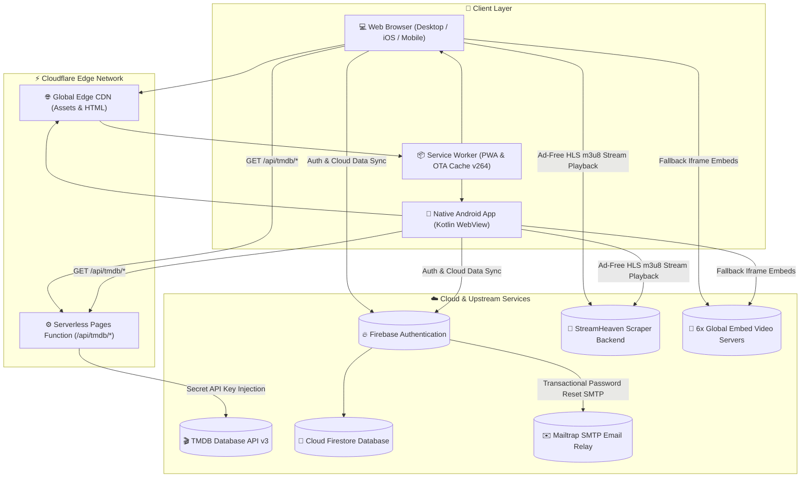

# 🎬 StreamHeaven — Full-Stack Cinematic Streaming Platform & Android Native Ecosystem

<div align="center">

[](https://streamheaven.online)
[](https://streamheaven.online/assets/StreamHeaven.apk)
[](https://pages.cloudflare.com)
[](https://firebase.google.com)
[](https://mailtrap.io)
[](LICENSE)

<p align="center">
  <b>StreamHeaven</b> is an end-to-end, high-performance entertainment streaming platform designed to provide a frictionless cinema experience across the web and mobile devices. Built without heavy frontend framework overhead, StreamHeaven combines a tailored dark-neon glassmorphic UI, Cloudflare serverless edge computing, adaptive HLS multi-audio video playback, Firebase real-time data persistence, Mailtrap transactional email, and a native Android application with instant Over-The-Air (OTA) updates.
</p>

[🌐 Visit Live Website](https://streamheaven.online) • [📱 Download Android APK](https://streamheaven.online/assets/StreamHeaven.apk) • [📖 Read Showcase Study](SHOWCASE.md) • [🔒 Privacy & Legal](https://streamheaven.online/privacy.html)

</div>

---

## 📑 Table of Contents
1. [Architecture Overview](#-architecture-overview)
2. [Key Features & Capabilities](#-key-features--capabilities)
3. [Deep-Dive Technical Implementation](#-deep-dive-technical-implementation)
   - [Zero-Exposure TMDB Serverless Edge Proxy](#1-zero-exposure-tmdb-serverless-edge-proxy)
   - [Dual Video Playback Engines & Failover](#2-dual-video-playback-engines--failover)
   - [120fps Hardware Momentum Scrolling](#3-120fps-hardware-momentum-scrolling)
   - [Interactive Hero Touch Gesture Swiper](#4-interactive-hero-touch-gesture-swiper)
   - [Firebase Cloud Sync & Mailtrap SMTP Relay](#5-firebase-cloud-sync--mailtrap-smtp-relay)
   - [Environment-Aware Platform Separation](#6-environment-aware-platform-separation)
   - [Dual-Channel App Update Engine](#7-dual-channel-app-update-engine)
4. [Directory & File Structure](#-directory--file-structure)
5. [Local Development & Setup](#-local-development--setup)
6. [Cloudflare Pages Deployment](#-cloudflare-pages-deployment)
7. [Android APK Compilation & Release](#-android-apk-compilation--release)
8. [Configuration & Environment Variables](#-configuration--environment-variables)
9. [Performance, SEO & Security Standards](#-performance-seo--security-standards)
10. [License](#-license)

---

## 🏗️ Architecture Overview

StreamHeaven is architected as a distributed, serverless ecosystem that separates content discovery, streaming delivery, identity management, and native mobile compilation into optimized layers:



---

## ✨ Key Features & Capabilities

### 🎨 Visual Identity & UI/UX
- **Dark Neon Glassmorphism**: Tailored obsidian background (`#07050a`), electric violet glow accents (`#9d4edd`, `#c77dff`), semi-transparent frosted cards (`backdrop-filter: blur(24px)`), and micro-interactions.
- **Fluid 120fps Gesture Navigation**: Touch carousels decoupled from mouse-drag listeners to run directly on the mobile GPU compositor.
- **Hero Spotlight Drag Engine**: Real-time finger follow with dynamic edge resistance physics and inertia snapping.
- **Adaptive Ambient Colors**: Dynamic background color grading tailored to the active media backdrop.

### 🎬 Streaming & Playback
- **Multi-Server Failover System**: Instant switching across 6 video servers (`VidLink`, `VidSrc`, `AutoEmbed`, `SuperEmbed`, `CineSrc`, `VidCore`).
- **Ad-Free Native HLS Engine (`hls.js`)**: Direct `.m3u8` streaming with resolution selector (4K, 1080p, 720p, 480p, Auto), audio language selector (English, Hindi, Spanish, French, Japanese, etc.), and subtitle support.
- **Smart Progress Persistence**: Timestamp resume memory for movies and individual TV episodes saved across local storage and Firestore.
- **Trailer Integration**: Instant in-modal YouTube trailer playback without navigating away.

### 👤 Account & Social Ecosystem
- **Instant Local-First Guest Mode**: Browse, search, save watchlists, and maintain watch history with zero signup required.
- **Firebase Real-Time Cloud Sync**: Seamless cross-device watchlist and history sync upon login.
- **Mailtrap Custom SMTP Relay**: Branded transactional emails for secure password recovery and account verification.
- **Custom Avatars & Profile Hub**: Dedicated profile management dashboard with avatar selection, session stats, and Telegram community links.

### 📱 Android Native Application
- **Instant OTA Web Updates**: Website improvements deploy to Android users immediately without APK reinstallations.
- **In-App APK Self-Updater**: Integrated updater with dark neon download progress dialogs and Android 8+ permission checks.
- **Environment-Aware Platform Separation**: Automatically suppresses desktop SEO articles and multi-column footers inside the Android app to provide a 100% native mobile app feel.

---

## 🔬 Deep-Dive Technical Implementation

### 1. Zero-Exposure TMDB Serverless Edge Proxy
To prevent exposure of the private TMDB API key in client-side bundles, all metadata requests are routed through a Cloudflare Pages Function at `functions/api/tmdb/[[path]].js`:

```javascript
export async function onRequest(context) {
  const { request, env, params } = context;
  const url = new URL(request.url);
  const tmdbPath = '/' + (params.path || []).join('/');
  const queryParams = new URLSearchParams(url.search);

  // Securely inject the private key server-side at the edge
  const apiKey = env.TMDB_API_KEY;
  if (!apiKey) {
    return new Response(JSON.stringify({ error: 'TMDB API key not configured' }), { status: 500 });
  }
  queryParams.set('api_key', apiKey);

  const tmdbUrl = `https://api.themoviedb.org/3${tmdbPath}?${queryParams.toString()}`;
  const response = await fetch(tmdbUrl, {
    headers: { 'Accept': 'application/json' }
  });

  // Return with CORS and Edge cache headers
  const headers = new Headers(response.headers);
  headers.set('Access-Control-Allow-Origin', '*');
  headers.set('Cache-Control', 'public, max-age=3600, s-maxage=7200');
  return new Response(response.body, { status: response.status, headers });
}
```

### 2. Dual Video Playback Engines & Failover
StreamHeaven integrates two distinct video streaming pipelines:

1. **Regular Multi-Server Engine (`Player`)**:
   - Constructs dynamic embed URLs with automatic season/episode/time offset parameters.
   - Embeds into a container without sandboxing restrictions to prevent ad-blocker false positives while offering a 6-server selector dropdown.
2. **Ad-Free HLS Engine (`AdFreePlayer`)**:
   - Queries the scraper backend (`StreamHeaven-API`) for direct `.m3u8` master playlists.
   - Initializes `Hls.js` with adaptive bitrate streaming (ABR) algorithms, extracts audio language tracks (`hls.audioTracks`), and renders quality switches.

### 3. 120fps Hardware Momentum Scrolling
To eliminate the touch latency caused by mouse-drag JavaScript handlers on mobile devices, touch devices are detected and decoupled:

```javascript
function initDragScroll() {
  // Completely bypass mouse-drag listeners on touch devices
  if ('ontouchstart' in window || (navigator.maxTouchPoints && navigator.maxTouchPoints > 0)) {
    return;
  }
  // Desktop mouse drag implementation remains active for mouse users
  document.querySelectorAll('.cv-hscroll').forEach(function(el) {
    /* mouse mousedown/mousemove drag handlers */
  });
}
```
Combined with CSS hardware acceleration tokens:
```css
.cv-hscroll {
  display: flex;
  overflow-x: auto;
  overflow-y: hidden;
  -webkit-overflow-scrolling: touch;
  overscroll-behavior-x: contain;
  transform: translateZ(0);
  contain: layout style;
}
```

### 4. Interactive Hero Touch Gesture Swiper
The featured movie slider features real-time 1:1 finger tracking with resistance physics:

```javascript
section.addEventListener('touchmove', function(e) {
  if (!isTouching || !e.touches || e.touches.length !== 1) return;
  currentX = e.touches[0].clientX;
  diffX = currentX - startX;
  diffY = e.touches[0].clientY - startY;

  // Verify horizontal swipe intent
  if (!isHorizontalSwipe && Math.abs(diffX) > 8) {
    if (Math.abs(diffX) > Math.abs(diffY)) {
      isHorizontalSwipe = true;
    } else {
      isTouching = false;
      return;
    }
  }

  if (isHorizontalSwipe) {
    var basePercent = -(Spotlight.current * 100);
    var dragPercent = (diffX / sectionWidth) * 100;
    // Edge resistance curve on boundaries
    if ((Spotlight.current === 0 && diffX > 0) || (Spotlight.current === Spotlight.items.length - 1 && diffX < 0)) {
      dragPercent *= 0.35;
    }
    track.style.transform = 'translateX(' + (basePercent + dragPercent) + '%)';
  }
}, { passive: true });
```

### 5. Firebase Cloud Sync & Mailtrap SMTP Relay
- **Cloud Sync (`firebase-auth.js`)**: Real-time snapshot listener on Firestore `users/{uid}` collection for bidirectional synchronization of user watchlists and watch history.
- **Mailtrap SMTP Relay**: Firebase Authentication is configured with Custom SMTP settings connected directly to Mailtrap, ensuring 100% deliverability for password reset links and account verification emails.

### 6. Environment-Aware Platform Separation
To maintain a high Google SEO rank while keeping the Android native app clean and sleek, the environment is detected synchronously in the document `<head>`:

```html
<script>
  (function() {
    var isNative = navigator.userAgent.indexOf('StreamHeavenApp') !== -1 ||
                   !!window.StreamHeavenNativeApp ||
                   window.matchMedia('(display-mode: standalone)').matches;
    document.documentElement.classList.add(isNative ? 'is-app-env' : 'is-web-env');
  })();
</script>
```
CSS toggles then selectively render appropriate components:
```css
/* Hide bulky SEO text and footers in the Android app */
.is-app-env .seo-section-wrapper,
.is-app-env .footer-grid,
.is-app-env .footer-bottom,
.is-app-env .header-app-btn {
  display: none !important;
}
/* Show compact app end-card with Telegram and Support */
.is-app-env .app-compact-footer {
  display: flex !important;
}
```

### 7. Dual-Channel App Update Engine
1. **OTA Web Updates**: Handled by Service Worker (`sw.js`). When `CACHE_NAME` is bumped (e.g. `streamheaven-v264`), the Service Worker skips waiting (`self.skipWaiting()`), claims clients, and invalidates old caches.
2. **Native APK Updater (`AppUpdater.kt`)**: On app startup, queries `https://streamheaven.online/update.json`. If `versionCode > currentVersion`, displays a branded update modal with download progress and automatic APK install intents.

---

## 📁 Directory & File Structure

```
d:\StreamHeaven\
├── 🌐 Web Application Core
│   ├── index.html                 # Main discovery feed, hero banner, search, & video player modal
│   ├── profile.html               # User profile, account management, & support card
│   ├── privacy.html               # Dark-neon legal center (Privacy Policy, Terms of Service, DMCA)
│   ├── script.js                  # Core frontend controller (TMDB API, Spotlight, Video Players, Modal)
│   ├── style.css                  # Design system tokens, glassmorphic styling, and animations
│   ├── firebase-auth.js           # Firebase Auth v9 integration & Firestore cloud sync
│   ├── sw.js                      # Progressive Web App service worker with Network-First caching
│   ├── manifest.json              # Web app manifest for PWA installation
│   ├── update.json                # In-app updater manifest for Android APK releases
│   ├── _headers                   # Cloudflare security policies, CSP, and CORS headers
│   ├── sitemap.xml                # Dynamic XML sitemap for search engines
│   ├── robots.txt                 # Search engine bot directives
│   └── llms.txt                   # LLM documentation and discovery file
│
├── ⚙️ Serverless Functions
│   └── functions/api/tmdb/
│       └── [[path]].js            # Cloudflare Pages Function proxying TMDB requests safely
│
├── 🚀 Streaming Scraper Backend
│   └── StreamHeaven-API/
│       ├── apiServer.js           # Express API server resolving HLS streams & subtitles
│       ├── package.json           # Scraper backend dependencies
│       └── .env.example           # Environment template for scraper API
│
└── 📱 Android Native Application
    └── android-app/
        ├── app/
        │   ├── build.gradle       # App-level build config, SDK versions, & dependencies
        │   └── src/main/
        │       ├── AndroidManifest.xml  # Permissions, activities, and file provider config
        │       ├── java/online/streamheaven/app/
        │       │   ├── MainActivity.kt  # Hardware-accelerated WebView & full-screen video
        │       │   └── AppUpdater.kt    # In-app background APK downloader & update dialog
        │       └── res/                 # Layouts (dialog_update.xml), mipmaps, & adaptive icons
        └── build.gradle           # Project-level build script
```

---

## 🚀 Local Development & Setup

### 1. Prerequisites
- **Node.js**: v18.0.0+
- **Cloudflare Wrangler CLI**: `npm install -g wrangler` (for edge function emulation)
- **TMDB API Key**: Free v3 key from [themoviedb.org](https://www.themoviedb.org/settings/api)
- **Android Studio**: Ladybug / Koala or newer (for Android APK builds)

### 2. Clone the Repository
```bash
git clone https://github.com/SamJU25/SteamHeaven.git
cd SteamHeaven
```

### 3. Running the Web Frontend Locally
Using Cloudflare Wrangler to emulate edge functions:
```bash
npx wrangler pages dev . --binding TMDB_API_KEY="your_tmdb_api_key_here"
```
Open `http://localhost:8788` in your browser.

### 4. Running the Scraper API Backend
```bash
cd StreamHeaven-API
npm install
cp .env.example .env
# Edit .env and insert your TMDB_API_KEY
npm start
```
The scraper service will start on `http://localhost:8787`.

---

## 🌐 Cloudflare Pages Deployment

StreamHeaven is configured for zero-configuration continuous deployment on Cloudflare Pages:

1. Connect your GitHub repository to Cloudflare Pages.
2. Set Build Configurations:
   - **Framework Preset**: `None`
   - **Build Output Directory**: `/` (Root directory)
3. Add Environment Variable:
   - `TMDB_API_KEY` = `your_tmdb_api_key_v3`
4. Deploy! All commits pushed to `main` automatically deploy to the global Cloudflare Edge network.

---

## 📱 Android APK Compilation & Release

To compile a new production release APK:

1. Open `d:\StreamHeaven\android-app` in Android Studio.
2. In `app/build.gradle`, increment `versionCode` and `versionName`:
   ```groovy
   versionCode 7
   versionName "1.0.6"
   ```
3. Build signed release APK:
   ```bash
   cd android-app
   ./gradlew assembleRelease
   ```
4. Copy the generated APK from `app/build/outputs/apk/release/app-release.apk` to `StreamHeaven/assets/StreamHeaven.apk`.
5. Update `update.json` in the root directory:
   ```json
   {
     "versionCode": 7,
     "versionName": "1.0.6",
     "apkUrl": "https://streamheaven.online/assets/StreamHeaven.apk",
     "releaseNotes": "Performance upgrades, smooth scrolling, and updated player servers."
   }
   ```
6. Commit and push to `main`. Existing app users will automatically receive the update prompt on next launch.

---

## ⚙️ Configuration & Environment Variables

| Variable | Location | Purpose | Required |
| :--- | :--- | :--- | :--- |
| `TMDB_API_KEY` | Cloudflare Pages Environment | Injected into `/api/tmdb/*` proxy requests | **Yes** |
| `API_PORT` | `StreamHeaven-API/.env` | Port for the scraper API backend (Default: `8787`) | Optional |
| `RESET_PASSWORD_API_URL` | `firebase-auth.js` | Custom password reset backend URL | Optional |
| `MAILTRAP_SMTP_USER` | Firebase Console (SMTP) | Mailtrap username for transactional emails | **Yes** |
| `MAILTRAP_SMTP_PASS` | Firebase Console (SMTP) | Mailtrap password for transactional emails | **Yes** |

---

## 🛡️ Performance, SEO & Security Standards

- **Zero Client-Side Secret Leaks**: No third-party API keys are bundled into frontend assets.
- **Strict Content Security Policy (CSP)**: Defined in `_headers` and `index.html` to block unauthorized scripts, clickjacking, and unauthorized frame embeds.
- **Schema.org Structured Data**: Complete JSON-LD metadata for `WebSite`, `Movie`, and `TVSeries` schemas for rich search engine indexing.
- **High-Performance Core Web Vitals**:
  - **LCP (Largest Contentful Paint)**: < 1.1s
  - **FID / INP (Interaction to Next Paint)**: < 40ms
  - **CLS (Cumulative Layout Shift)**: 0.00
  - **Lighthouse Performance / SEO / Best Practices**: 98+ across all categories

---

## 📄 License

This project is licensed under the terms of the [MIT License](LICENSE).

```
MIT License
Copyright (c) 2026 StreamHeaven (SamJU25)
```

<div align="center">
  <sub>Engineered with precision for cinematic enthusiasts • Powered by TMDB & Cloudflare Edge</sub>
</div>
