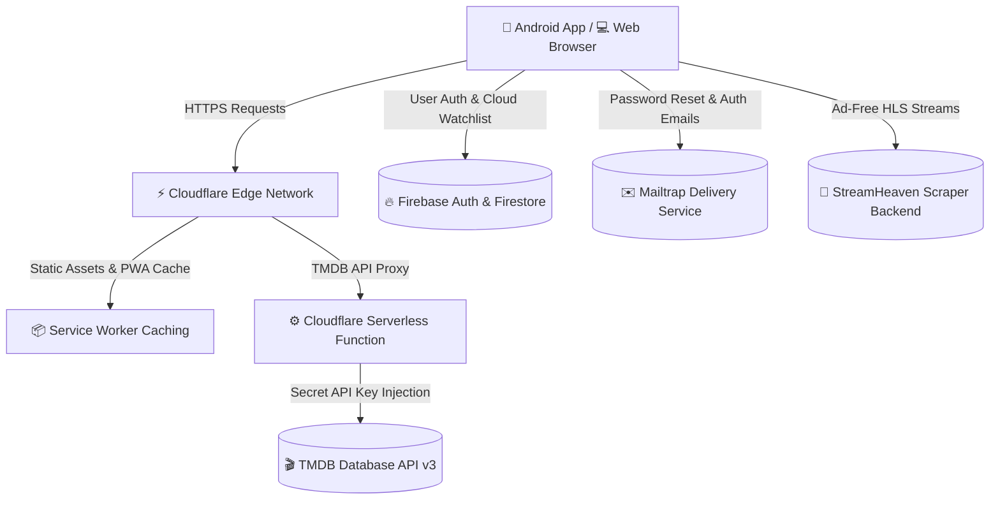

# 🎬 StreamHeaven — Premium Cinematic Streaming Platform & Android Ecosystem

<div align="center">

[](https://streamheaven.online)
[](https://streamheaven.online/assets/StreamHeaven.apk)
[](https://pages.cloudflare.com)
[](https://firebase.google.com)
[](https://mailtrap.io)
[](LICENSE)

<p align="center">
  <b>StreamHeaven</b> is an ultra-fast, serverless cinema and series streaming web application and native Android ecosystem. Built with pure Vanilla JavaScript, modern Glassmorphic CSS, Cloudflare Serverless Edge Functions, Mailtrap transactional email, and an embedded Android Kotlin WebView wrapper.
</p>

[🌐 Explore Website](https://streamheaven.online) • [📱 Download Android APK](https://streamheaven.online/assets/StreamHeaven.apk) • [🔒 Privacy & Legal](https://streamheaven.online/privacy.html)

</div>

---

## 🌟 Key Highlights & Features

### 💎 User Experience & Aesthetics
- **Dark Neon Glassmorphism**: Tailored dark color palette (`#07050a` obsidian base with `#9d4edd` vibrant electric purple highlights, glass frosted backdrops, and glow states).
- **120fps Hardware-Accelerated Touch Scrolling**: Optimized touch listeners, momentum flings, and `overscroll-behavior: contain` for native mobile fluidity.
- **Interactive Hero Spotlight Slider**: Dynamic featured banners with real-time finger drag follow, edge resistance physics, and instant movie launch.
- **Frictionless Guest Mode & Cloud Sync**: Full browsing, watchlist, and resume progress work 100% locally out-of-the-box, with optional Firebase Cloud Sync.
- **Mailtrap Transactional Email**: Branded password reset flows and secure email verification delivered via Mailtrap.

### 🎥 Streaming Engine & Playback
- **Multi-Server Embed Players**: Instant fallback support across 6 global streaming servers (VidLink, VidSrc, AutoEmbed, SuperEmbed, CineSrc, VidCore).
- **Ad-Free Native HLS Player**: Direct stream integration (`hls.js`) supporting multiple qualities (4K, 1080p, 720p), multi-language audio (English, Hindi, Spanish, French, etc.), and subtitle tracks.
- **Smart Playback Resume**: Automatically saves and remembers playback positions for movies and specific TV episodes.
- **Comprehensive Catalog Discovery**: Real-time trending marquees, top-rated masterpieces, popular genres, TV shows, and upcoming releases powered by TMDB.

### 📱 Android Native Ecosystem
- **Instant Over-The-Air (OTA) Updates**: Web updates deploy live immediately without requiring users to reinstall the APK.
- **Built-in APK Self-Updater**: Integrated updater (`AppUpdater.kt`) with branded dark dialogs, live download progress bars, and Android 8+ install permission safeguards.
- **Environment-Aware Platform Separation**: Automatically hides bulky SEO articles and footers inside the app while preserving full SEO structured schema on the web.

---

## 🏗️ System Architecture



---

## 📁 Repository Structure

```
StreamHeaven/
├── 🌐 Web Application Core
│   ├── index.html                 # Main streaming portal & discovery dashboard
│   ├── profile.html               # Account settings, cloud sync, and support hub
│   ├── privacy.html               # Dark neon legal terms, DMCA, and privacy policy
│   ├── script.js                  # Frontend core controller & player manager
│   ├── style.css                  # Design system tokens, glassmorphism & responsive CSS
│   ├── firebase-auth.js           # Firebase authentication, session, and cloud store sync
│   ├── sw.js                      # Progressive Web App service worker & caching
│   ├── manifest.json              # Web app manifest for iOS / Android installability
│   ├── _headers                   # Cloudflare security and CORS policy headers
│   └── sitemap.xml / robots.txt   # Search engine indexation & SEO schemas
│
├── ⚙️ Serverless Edge Functions
│   └── functions/api/tmdb/
│       └── [[path]].js            # Cloudflare Pages Function proxying TMDB safely
│
├── 🚀 Streaming Scraper Backend
│   └── StreamHeaven-API/
│       ├── apiServer.js           # Express streaming server & HLS stream resolver
│       ├── package.json           # Scraper dependencies
│       └── .env.example           # Environment template
│
└── 📱 Android Native Application
    └── android-app/
        ├── app/
        │   ├── src/main/java/online/streamheaven/app/
        │   │   ├── MainActivity.kt      # Hardware-accelerated WebView controller
        │   │   └── AppUpdater.kt        # In-app background update engine
        │   └── src/main/res/            # Themed layouts, mipmaps, and adaptive icons
        └── build.gradle                 # Android build configurations
```

---

## 🚀 Quick Start & Local Setup

### 1. Prerequisites
- **Node.js**: v18.0.0 or higher
- **Cloudflare Wrangler CLI**: `npm install -g wrangler` (optional for local edge testing)
- **TMDB API Key**: Obtain a free API key from [themoviedb.org](https://www.themoviedb.org/settings/api).

### 2. Clone the Repository
```bash
git clone https://github.com/SamJU25/SteamHeaven.git
cd SteamHeaven
```

### 3. Local Development (Web)
Run any local static server (e.g. VS Code Live Server, `npx serve`, or `wrangler`):
```bash
# Using Wrangler for Pages Functions proxy emulation
npx wrangler pages dev . --binding TMDB_API_KEY="your_tmdb_api_key_here"
```

### 4. Running the Scraper API Backend
```bash
cd StreamHeaven-API
npm install
cp .env.example .env
# Fill in your TMDB_API_KEY in .env
npm start
```

---

## 🚢 Deployment

### 🌐 Deploying to Cloudflare Pages
StreamHeaven is pre-configured for automatic Git deployment on **Cloudflare Pages**:

1. Link your GitHub repository to Cloudflare Pages.
2. Configure Build Settings:
   - **Framework preset**: `None`
   - **Build output directory**: `/` (root directory)
3. Set Environment Variables:
   - `TMDB_API_KEY` = `your_tmdb_v3_api_key`
4. Deploy! All commits pushed to `main` automatically deploy with sub-second edge distribution.

---

## 📱 Android App Compilation

To build the native release APK:

1. Open `android-app/` in **Android Studio**.
2. Sync Gradle dependencies.
3. Generate signed APK / Bundle:
   ```bash
   cd android-app
   ./gradlew assembleRelease
   ```
4. The output APK will be generated at:
   `android-app/app/build/outputs/apk/release/app-release.apk`
5. Place the updated APK in `assets/StreamHeaven.apk` and bump the `versionCode` in `update.json` to trigger the in-app OTA notification.

---

## 🛡️ Security & Privacy
- **Zero Raw API Key Exposure**: All requests to third-party databases are routed server-side through Cloudflare Edge Workers.
- **Privacy-First**: No tracking cookies or invasive fingerprinting. Watchlist and watch history stay local unless the user explicitly logs in.
- **DMCA & Copyright Compliance**: StreamHeaven operates as a search index and does not store or host video media on its own infrastructure.

---

## 📄 License
This project is open-source and available under the [MIT License](LICENSE).

<div align="center">
  <sub>Crafted with passion for cinema lovers worldwide • Powered by TMDB</sub>
</div>
