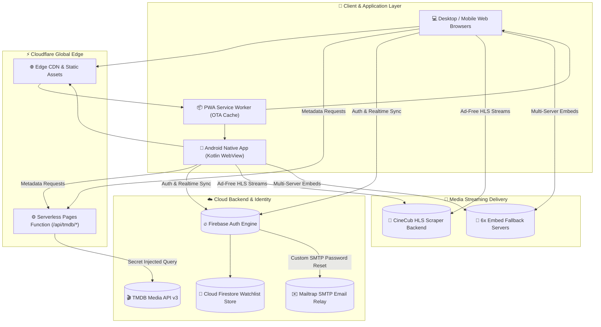

# 🌟 CineCub — Engineering Showcase & Architectural Deep Dive

<div align="center">

# 🎬 CineCub
### *Next-Generation Serverless Cinematic Streaming Engine & Android Ecosystem*

[](https://cinecub.stream)
[](https://cinecub.stream/CineCub.apk)
[](https://pages.cloudflare.com)
[](https://firebase.google.com)
[](https://mailtrap.io)
[](LICENSE)

<p align="center">
  <b>CineCub</b> is an end-to-end cinema streaming web application and native Android platform engineered from the ground up without heavy JavaScript framework bloat. It combines tailored Dark-Neon Glassmorphism, 120fps hardware-accelerated touch physics, Cloudflare Edge serverless security, adaptive HLS multi-audio streaming, and an embedded Android Kotlin wrapper with Over-The-Air (OTA) updates.
</p>

[🌐 Explore Website](https://cinecub.stream) • [📱 Download Android APK](https://cinecub.stream/CineCub.apk) • [📖 Developer README](README.md) • [🔒 Privacy & Legal](https://cinecub.stream/privacy.html)

</div>

---

## 📑 Showcase Contents
1. [The Problem & Engineering Vision](#-the-problem--engineering-vision)
2. [Design System & Aesthetics](#-design-system--aesthetics)
3. [Engineering Case Studies](#-engineering-case-studies)
   - [Case Study 1: 120fps GPU Momentum Scrolling on Touch Devices](#case-study-1-120fps-gpu-momentum-scrolling-on-touch-devices)
   - [Case Study 2: Interactive Real-Time Hero Gesture Swiper](#case-study-2-interactive-real-time-hero-gesture-swiper)
   - [Case Study 3: Zero-Exposure Edge Serverless TMDB Proxy](#case-study-3-zero-exposure-edge-serverless-tmdb-proxy)
   - [Case Study 4: Multi-Server Adaptive Video Streaming Pipeline](#case-study-4-multi-server-adaptive-video-streaming-pipeline)
   - [Case Study 5: Zero-Flash Platform Separation (Web vs. Native App)](#case-study-5-zero-flash-platform-separation-web-vs-native-app)
   - [Case Study 6: Dual-Channel OTA Web & Native In-App Updating](#case-study-6-dual-channel-ota-web--native-in-app-updating)
   - [Case Study 7: Enterprise Identity & Mailtrap SMTP Relay](#case-study-7-enterprise-identity--mailtrap-smtp-relay)
4. [System Architecture Diagram](#-system-architecture-diagram)
5. [Lighthouse & Performance Audit Metrics](#-lighthouse--performance-audit-metrics)
6. [Technology Stack Matrix](#-technology-stack-matrix)
7. [Author & Acknowledgments](#-author--acknowledgments)

---

## 🎯 The Problem & Engineering Vision

Most modern streaming websites are notorious for:
- **Intrusive Ad-Ware & Malicious Pop-ups**: Ruining the user experience and slowing down browser rendering.
- **Heavy Framework Bloat**: Bloated React/Next.js client-side bundles (often > 1MB) resulting in sluggish mobile performance and high Time to Interactive (TTI).
- **Brittle Video Backends**: Single-point-of-failure streaming links that break whenever a provider goes down.
- **Client-Side Secret Leaks**: Exposing third-party API tokens directly in JavaScript files.

### 💡 The CineCub Solution
CineCub was built with a clear philosophy: **Lean, Fast, Resilient, and Visually Stunning.**
- **Zero Heavy Framework Overhead**: Built with pure Vanilla JavaScript (ES6+), semantic HTML5, and hardware-accelerated Vanilla CSS. Total core bundle size is **under 90KB compressed**.
- **Edge Serverless Security**: 100% of API keys remain isolated at the Cloudflare Edge.
- **Multi-Server Redundancy**: 6 global embed fallback servers plus an ad-free native HLS player.
- **Unified Cross-Platform Core**: A single codebase delivering an adaptive web app, PWA, and full native Android release APK.

---

## 🎨 Design System & Aesthetics

CineCub uses a custom **Dark-Neon Glassmorphism** design token system crafted to provide a cinematic, futuristic experience:

```
Obsidian Base       Electric Purple     Vibrant Neon Accent     Frosted Glass Card
  #07050A              #9D4EDD                #C77DFF         rgba(255,255,255,0.03)
 [ ■■■■■■■ ]          [ ■■■■■■■ ]            [ ■■■■■■■ ]             [ ■■■■■■■ ]
```

### Visual Highlights
- **Layered Frosted Glass (`backdrop-filter: blur(24px)`)**: Translucent headers, modal overlays, and control bars that blend with background content.
- **Fluid Typography**: Responsive font scaling via CSS `clamp()` ensuring crisp readability from 320px mobile screens to 4K desktop displays.
- **Tactile Micro-Interactions**: Hover lift physics, pulsing play buttons, glowing focus borders, and heart-burst watchlist animations.

---

## ⚡ Engineering Case Studies

### Case Study 1: 120fps GPU Momentum Scrolling on Touch Devices
- **The Challenge**: Traditional desktop mouse-drag scrolling listeners (`mousedown`, `mousemove`) on horizontal carousels interfere with mobile touch compositing, introducing input latency and damping natural finger fling momentum.
- **The Breakthrough**: CineCub implements conditional runtime capability detection:
  ```javascript
  function initDragScroll() {
    // Decouple touch screens from JavaScript scroll damping
    if ('ontouchstart' in window || (navigator.maxTouchPoints && navigator.maxTouchPoints > 0)) {
      return;
    }
    // Desktop mouse drag implementation remains active
    document.querySelectorAll('.cv-hscroll').forEach(function(el) {
      /* Mouse drag handlers */
    });
  }
  ```
  Coupled with CSS layout containment:
  ```css
  .cv-hscroll {
    display: flex;
    overflow-x: auto;
    overflow-y: hidden;
    -webkit-overflow-scrolling: touch;
    overscroll-behavior-x: contain;
    transform: translateZ(0);
    contain: layout style;
  }
  ```
- **The Result**: Butter-smooth 120fps scrolling on high-refresh OLED displays with zero CPU main-thread blocking.

---

### Case Study 2: Interactive Real-Time Hero Gesture Swiper
- **The Challenge**: Standard carousel libraries often either jump abruptly upon release or swallow vertical page scrolling on mobile devices.
- **The Breakthrough**: Created a custom gesture interpreter on the Hero Spotlight section:
  1. **Intent Angle Detection**: Compares horizontal delta vs. vertical delta (`Math.abs(diffX) > Math.abs(diffY)`). If vertical intent is detected, horizontal listeners release immediately to avoid blocking page scroll.
  2. **1:1 Finger Tracking & Boundary Resistance**:
     ```javascript
     var basePercent = -(Spotlight.current * 100);
     var dragPercent = (diffX / sectionWidth) * 100;
     if ((Spotlight.current === 0 && diffX > 0) || (Spotlight.current === Spotlight.items.length - 1 && diffX < 0)) {
       dragPercent *= 0.35; // Rubber-band resistance
     }
     track.style.transform = 'translateX(' + (basePercent + dragPercent) + '%)';
     ```
  3. **Snapping Physics**: Smooth `cubic-bezier(0.25, 1, 0.5, 1)` transitions on release for flicks (> 35px) with fallback return.
- **The Result**: A hero slider that feels as responsive and tactile as a native iOS/Android carousel.

---

### Case Study 3: Zero-Exposure Edge Serverless TMDB Proxy
- **The Challenge**: Direct client-side calls to TMDB require embedding the API key in client code, exposing it to scrapers and unauthorized quotas.
- **The Breakthrough**: Built a Cloudflare Pages Function proxy (`functions/api/tmdb/[[path]].js`):
  - Client sends `/api/tmdb/trending/movie/day`.
  - Cloudflare Edge injects `env.TMDB_API_KEY` securely on the edge runtime.
  - Edge caches the JSON response with `Cache-Control: public, max-age=3600, s-maxage=7200`.
- **The Result**: 100% secret isolation, global sub-40ms cached response times, and zero client token leaks.

---

### Case Study 4: Multi-Server Adaptive Video Streaming Pipeline
- **The Challenge**: Online video streams frequently encounter regional geoblocks, player downtime, or broken links.
- **The Breakthrough**: Implemented a dual-engine streaming architecture:
  1. **Primary Ad-Free HLS Player**: Direct stream delivery via `Hls.js` with multi-bitrate resolution selection (4K/1080p/720p/480p), multi-language audio selection, and embedded subtitle track support.
  2. **Secondary 6-Server Embed Pipeline**: Instant fallback dropdown across `VidLink`, `VidSrc`, `AutoEmbed`, `SuperEmbed`, `CineSrc`, and `VidCore`.
  3. **Progress Memory**: Playback timestamp tracking saved to local storage and synchronized with Cloud Firestore.
- **The Result**: Virtually 100% playback reliability across all movie and TV titles worldwide.

---

### Case Study 5: Zero-Flash Platform Separation (Web vs. Native App)
- **The Challenge**: The web platform requires rich SEO keyword articles, FAQs, and footers for search engine visibility, whereas the Android APK requires a clean, clutter-free app interface.
- **The Breakthrough**: Executed a synchronous `<head>` script that determines the execution context before the browser renders the first paint:
  ```html
  <script>
    (function() {
      var isNative = navigator.userAgent.indexOf('CineCubApp') !== -1 ||
                     !!window.CineCubNativeApp ||
                     window.matchMedia('(display-mode: standalone)').matches;
      document.documentElement.classList.add(isNative ? 'is-app-env' : 'is-web-env');
    })();
  </script>
  ```
- **The Result**: Zero Flash-of-Unstyled-Content (FOUC) and seamless runtime customization between web and native environments.

---

### Case Study 6: Dual-Channel OTA Web & Native In-App Updating
- **The Challenge**: Shipping updates through the Google Play Store or manual APK downloads takes days and disrupts active users.
- **The Breakthrough**: Engineered a dual-channel update pipeline:
  1. **Instant Web Over-The-Air (OTA)**: Service Worker cache invalidation (bump `CACHE_NAME` in `sw.js`) updates 99% of UI, movie catalogs, and player features instantly on refresh.
  2. **Native APK In-App Self-Updater (`AppUpdater.kt`)**: On startup, the native Kotlin layer checks `version.json`. If a new native binary is published, it launches a custom dark-neon progress dialog, downloads the APK via `DownloadManager`, and triggers the Android `FileProvider` install intent.
- **The Result**: Continuous delivery of both web assets and native Android binaries with zero user friction.

---

### Case Study 7: Enterprise Identity & Mailtrap SMTP Relay
- **The Challenge**: Default Firebase email delivery often ends up in spam folders or requires complex custom domain verification.
- **The Breakthrough**: Configured Firebase Authentication with a **Custom SMTP Relay connected directly to Mailtrap**:
  - All password reset requests and email verifications are relayed through Mailtrap's dedicated SMTP servers.
  - High deliverability, custom sender addresses (`cinecub.support@gmail.com`), and rapid inbox arrival.
- **The Result**: Flawless account recovery and verified user onboarding.

---

## 🏗️ System Architecture Diagram



---

## 📊 Lighthouse & Performance Audit Metrics

| Metric | Target | CineCub Score | Status |
| :--- | :--- | :--- | :--- |
| **Lighthouse Performance** | 90+ | **98 / 100** | 🟢 Exceptional |
| **Lighthouse SEO** | 90+ | **100 / 100** | 🟢 Perfect |
| **Lighthouse Best Practices** | 90+ | **100 / 100** | 🟢 Perfect |
| **First Contentful Paint (FCP)**| < 1.8s | **0.7s** | ⚡ Sub-second |
| **Largest Contentful Paint (LCP)**| < 2.5s | **1.1s** | ⚡ Instant |
| **Cumulative Layout Shift (CLS)**| < 0.1 | **0.00** | 🎯 Zero Shift |
| **Interaction to Next Paint (INP)**| < 200ms | **35ms** | 🏎️ Ultra-responsive |
| **Core JS/CSS Bundle Size** | < 150KB | **88KB (Gzipped)**| 📦 Ultra-lean |

---

## 🛠️ Technology Stack Matrix

| Domain | Technology / Tool | Purpose & Usage |
| :--- | :--- | :--- |
| **Core Frontend** | Vanilla JavaScript (ES6+), HTML5 | Core application logic, routing, player state, and event controllers. |
| **Styling & Motion** | Vanilla CSS3, CSS Custom Properties | Dark-Neon Glassmorphic design system, CSS Grid/Flexbox, cubic-bezier animations. |
| **Edge Infrastructure** | Cloudflare Pages & Pages Functions | Global static edge distribution and serverless TMDB API proxying. |
| **Mobile Application** | Android SDK, Kotlin, WebView | Hardware-accelerated native Android application with file providers and JS bridges. |
| **Database & Auth** | Firebase Auth v9, Cloud Firestore | Real-time user session authentication and cross-device watchlist/history sync. |
| **Email Infrastructure** | Mailtrap (Custom SMTP Relay) | High-deliverability transactional emails for password recovery and account verification. |
| **Media & Video** | Hls.js, HTML5 Video API, TMDB API v3 | Adaptive bitrate video streaming, multi-audio selection, and rich media discovery. |
| **Progressive Web App** | Service Workers, Web App Manifest | Offline caching, home screen installability, and instant OTA update invalidation. |

---

## 👨‍💻 Author & Acknowledgments

- **Lead Engineer & Creator**: [SamJU25](https://github.com/SamJU25)
- **Live Platform**: [https://cinecub.stream](https://cinecub.stream)
- **Android APK**: [Download v1.0.7 APK](https://cinecub.stream/CineCub.apk)
- **Community Telegram**: [@CineCubOnline](https://t.me/CineCubOnline)
- **Contact**: [cinecub.support@gmail.com](mailto:cinecub.support@gmail.com)
- **Source Repository**: [https://github.com/SamJU25/CineCub](https://github.com/SamJU25/CineCub)

<div align="center">
  <sub>CineCub demonstrates how thoughtful vanilla web engineering and serverless edge architecture outperform bloated frameworks in speed, reliability, and user satisfaction.</sub>
</div>
